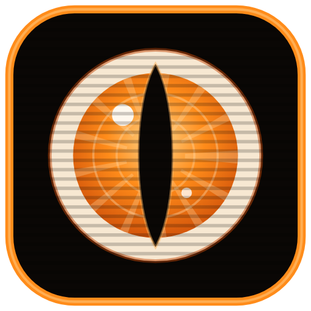

# TANDERA — o motor de análise de vídeo e som da Fly

Feito pelo Luan Carvalho (Fly). Você dá um vídeo; o Tandera devolve **tudo medido**: cada corte no quadro exato, cada palavra falada no
milissegundo, a batida e as partes da música, a voz separada da música e dos efeitos, os rótulos do som (porta, motor, multidão...), o
texto que aparece na tela, os momentos fortes, a ficha de cada plano (quem, onde, ação) e o retrato vídeo+som de cada trecho pra busca
(Ovis). Serve pra qualquer skill que precisa "assistir" um vídeo: análise de edição, sonoplastia, catálogo de bruto, roteiro.

**Um motor só, sempre o mais novo.** Cada peça tem versão; quando uma peça melhora, a próxima análise refaz SÓ ela e soma no que já
estava guardado.

## Instalar (o jeito mais fácil: pedir pro seu Claude)
Abra o **Claude Code** e escreva:

> instala o Tandera pra mim: https://github.com/luancarvalho-fly/tandera

Ele lê o `CLAUDE.md` deste repositório, roda o **PC check** e escolhe com você o caminho:

| a sua máquina | o caminho |
|---|---|
| Windows + placa NVIDIA (8 GB+) | tudo no seu PC |
| PC sem placa forte | o leve no seu PC + o pesado numa máquina alugada por hora no **RunPod** (`RUNPOD.md`) |
| Mac | em porte (`MAC.md`): o leve no processador do Mac, o pesado no RunPod |

## Gemma × Gemini
**A gente usa o Gemma 4 (local, de graça) pra substituir o Gemini** na hora de descrever o vídeo. **Mas você pode usar o Gemini pelos
créditos diários grátis** da sua própria chave do Google AI Studio: ele faz o diário do vídeo inteiro (vê e ouve) e liga a busca por
frase. Explicado em `GEMMA-E-GEMINI.md`.

## Arquivos
| | |
|---|---|
| `CLAUDE.md` | o passo a passo de instalação (pro seu Claude) |
| `LEIA-ME.md` | o manual do motor: comandos, peças, variáveis, servidor |
| `MODELOS.md` | cada modelo: fonte oficial, tamanho, licença |
| `RUNPOD.md` | rodar numa máquina alugada (quem não tem PC forte) |
| `GEMMA-E-GEMINI.md` | quem descreve o vídeo, e como ligar o Gemini grátis |
| `MAC.md` | o porte pro Mac, peça por peça |
| `referencia/` | os relatórios: o motor único, o Linux igual ao PC, o lote por peça, o piloto no RunPod |
| `exemplo/` | um vídeo de 12 s de resultado conhecido, pra provar a instalação |

## O que já foi testado
- **No PC do Luan, a partir deste repositório (03/11/2026):** o motor abre e responde a versão; o exemplo de 12 s dá IGUAL ao de
  referência em todas as peças (cortes, fala, batida, sinal, rótulos, música); o Kakashi transcreve uma gravação pelo Tandera clonado
  ao lado. É o mesmo código que ele usa todo dia.
- **No RunPod (01/11/2026):** o piloto de 4 vídeos e um lote de ~25 h de vídeo em 3 máquinas (`referencia/04-PILOTO-RUNPOD.md`).
- **Ainda não:** a instalação do zero (ambientes + modelos) num Windows de outra pessoa, e qualquer coisa no Mac. Se der erro, mande o
  print (ou um Kakashi) pro Luan.

## Licenças
O código do Tandera é da Fly, de uso interno. Alguns modelos são **não comerciais** (CoTracker3, MMS, os de rosto): uso interno da Fly
apenas. Detalhes em `MODELOS.md` e `LICENCAS-TERCEIROS.md`.

## Versões
Cada versão publicada é uma etiqueta `vAAAA.MM.DD`; o que mudou fica nos *Commits*. Pra atualizar: `git pull` na pasta (ou peça pro
seu Claude). As análises que você já tem continuam valendo: só a peça que mudou roda de novo.
